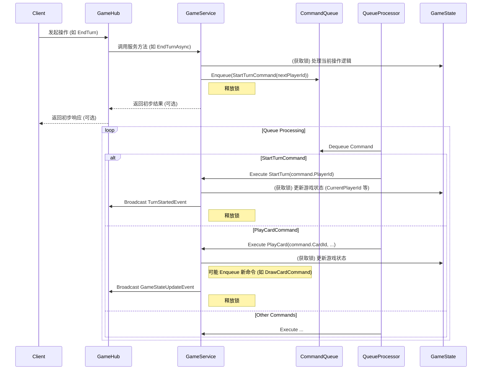

# 技术设计：命令/事件队列模式

## 1. 概述

为了提高游戏核心逻辑的健壮性、可扩展性，并解决潜在的竞态条件（如 BUG-011 中暴露的回合跳过问题），我们计划引入命令/事件队列模式来管理游戏内的操作执行流程。

该模式的核心思想是将游戏操作（如出牌、结束回合、触发效果）封装成独立的命令或事件对象，放入一个与特定游戏会话关联的队列中。一个专门的处理器按先进先出（FIFO）的顺序从队列中取出并执行这些命令/事件，从而保证操作的顺序性，并为处理复杂的连锁反应提供基础。

## 2. 设计目标

*   **顺序保证**: 确保游戏操作严格按照预期顺序执行。
*   **竞态条件规避**: 通过顺序化处理，消除因并发或异步调用导致的状态不一致问题（如 BUG-011）。
*   **连锁反应支持**: 为卡牌效果、触发器等连锁机制提供清晰、可控的实现方式。
*   **解耦**: 将操作的发起者与执行者解耦。
*   **可测试性/可追溯性**: (潜在) 记录命令历史，便于调试和回放。

## 3. 核心概念与流程

*   **命令/事件 (Command/Event)**: 代表一个具体游戏操作或状态变化的数据对象（如 `StartTurnCommand`, `PlayCardCommand`, `DamageDealtEvent`）。
*   **命令队列 (Command Queue)**: 每个活跃的游戏会话拥有一个队列，用于存储待处理的命令/事件。可以使用内存队列（如 `ConcurrentQueue<T>`）实现。
*   **队列处理器 (Queue Processor)**: 每个游戏会话对应一个后台任务/循环，负责从队列中取出命令/事件并调用相应的服务逻辑执行。处理器保证了命令的顺序执行。
*   **GameService**: 包含执行具体游戏逻辑的方法（如实际处理出牌、计算伤害、开始回合等）。这些方法会被队列处理器调用。
*   **GameState**: 游戏状态对象，由 `GameService` 的方法在执行命令时进行修改（需要考虑线程安全/锁）。
*   **GameHub**: 负责与客户端通信，接收客户端请求（并将请求转化为命令入队），以及在命令执行后将状态变化广播给客户端。

## 4. 对 BUG-011 的解决

`EndTurnAsync` 在完成回合结束处理后，不再直接调用 `StartPlayerTurnAsync` 或 `TriggerAiTurnAsync`，而是向队列中添加一个 `StartTurnCommand`。队列处理器保证了这个命令会在所有之前的操作（包括回合结束处理）完成后才被执行，从而避免了回合跳过的问题。

## 5. 实现要点

*   **队列管理**: `GameService` 或一个新服务负责创建、管理和销毁每个游戏会话的队列及处理器。
*   **处理器生命周期**: 处理器的启动、停止、错误处理。
*   **命令/事件定义**: 设计清晰、包含必要信息的命令/事件类。
*   **状态同步与锁**: 处理器在执行命令修改 `GameState` 时，仍需使用锁来保证原子性，但由于是单点顺序处理，锁的复杂性可能降低。
*   **客户端通知**: 命令执行成功后，处理器需要触发 `GameHub` 将必要的状态更新广播给客户端。

## 6. 未来扩展

此模式便于未来添加更复杂的卡牌效果、触发器、响应链等。